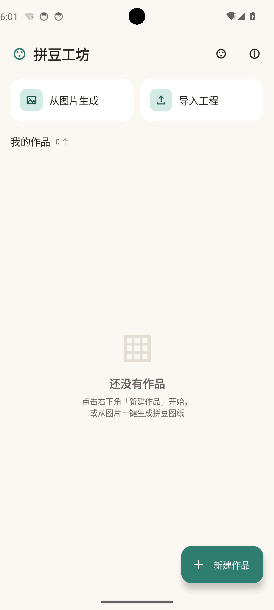
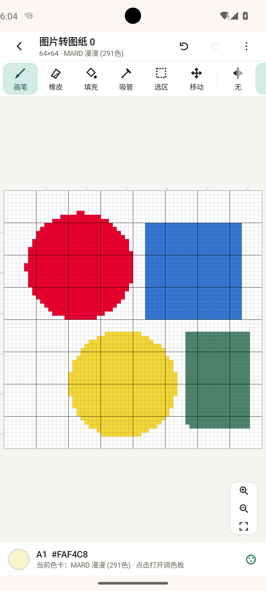
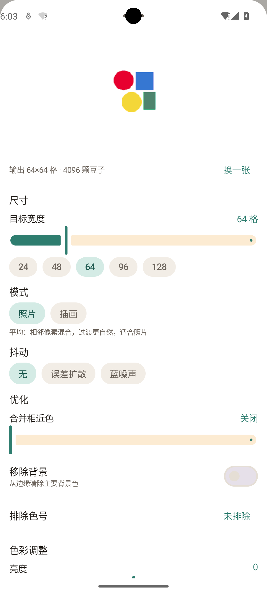
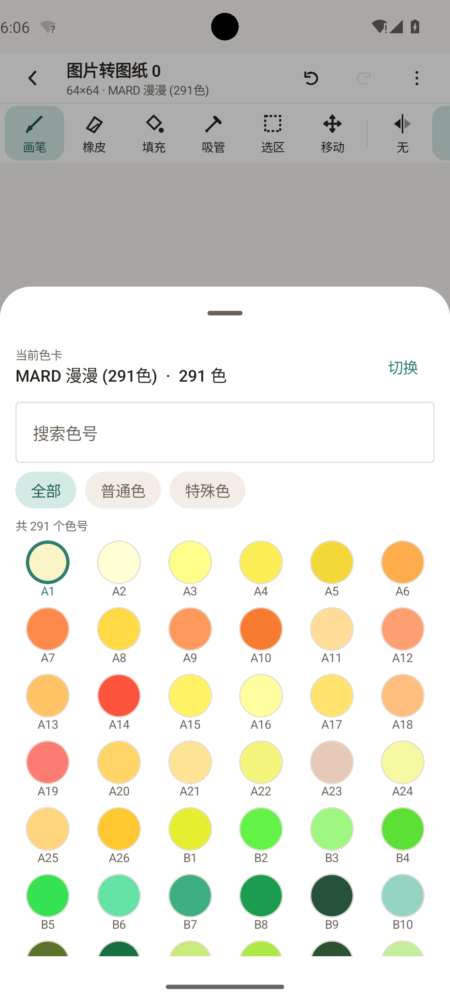
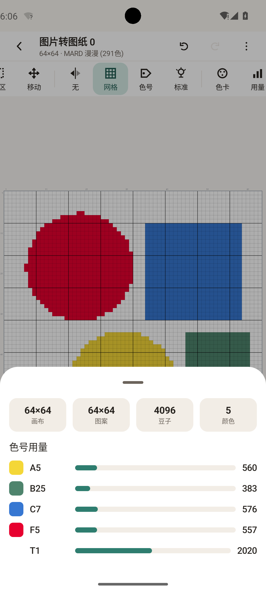
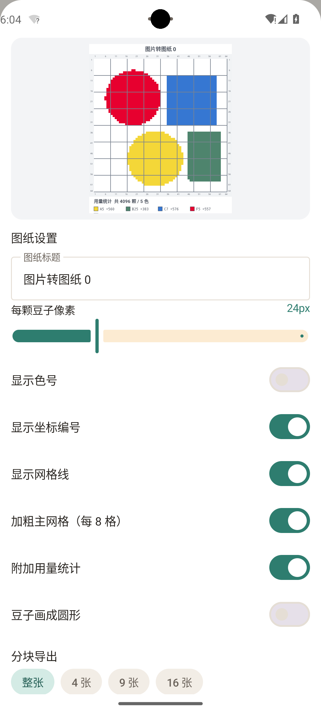
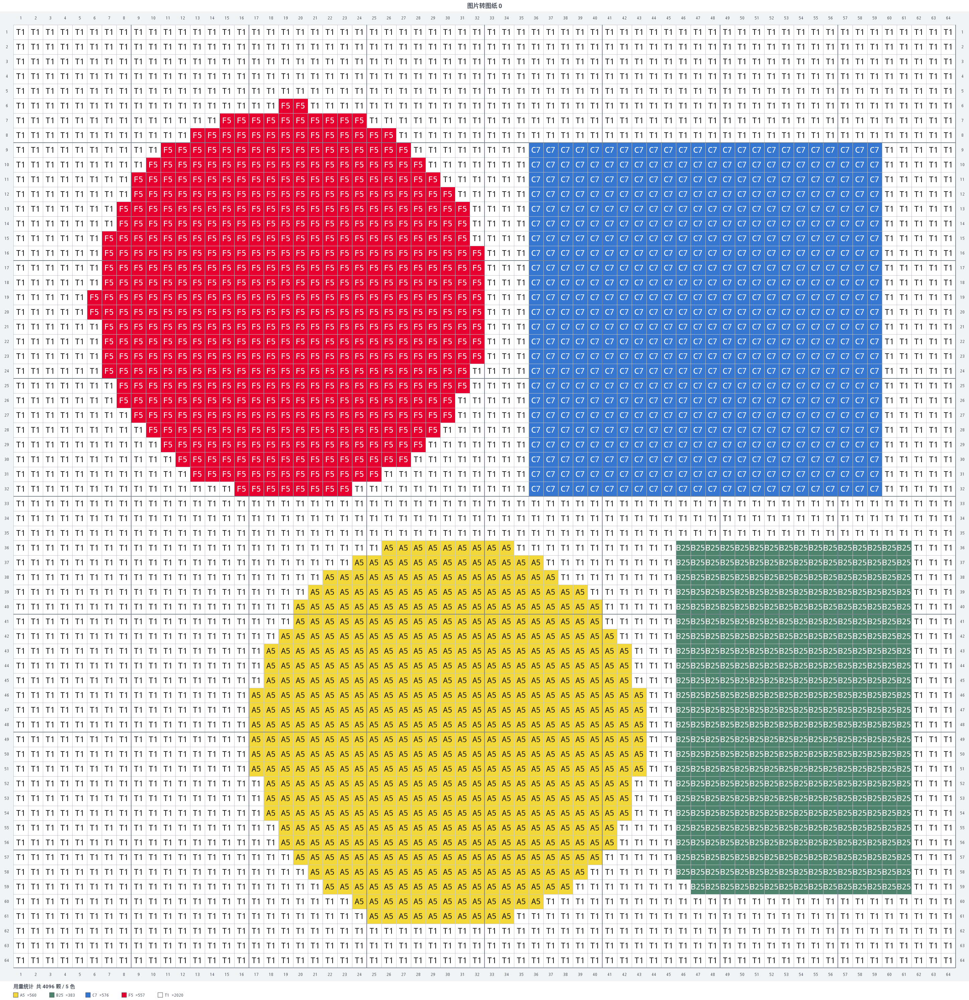
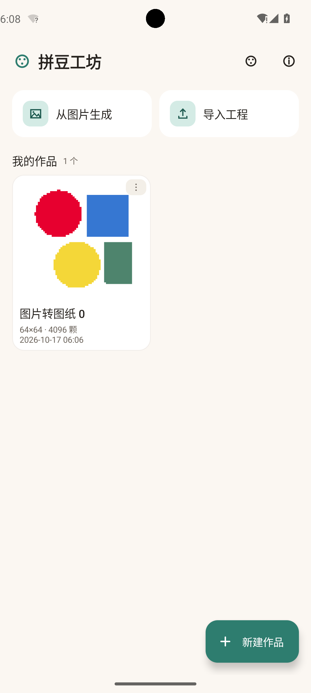

# 拼豆工坊 (Pindou Studio)

一款用 **Kotlin + Jetpack Compose** 编写的安卓拼豆图纸编辑器。

产品能力参考了两个网页项目：

| 参考项目 | 提供的产品能力 |
|---|---|
| `pindou-main`（拼豆图纸编辑器与分享社区，Next.js + PixiJS） | 无限/稀疏网格编辑器、画笔/橡皮/油漆桶/吸管、拖拽 Bresenham 插值、撤销重做、显示色号、OKLab 感知色差图片转图纸（平均/主色、合并相近色、移除背景、排除色号）、实时光珠用量、带坐标与色号的 PNG 图纸导出、多品牌色号库 |
| `pindou-draw-main`（纯前端拼豆草图工具） | 固定尺寸画布 + 扩裁、对称绘制、图像翻转/旋转、选区（新增/删除/移动）、底图叠加与吸附、参考图、色卡库（JSON/CSV 导入）、光变/温变/夜光/珠光特殊像素显示模式、Floyd–Steinberg / 蓝噪声抖动、坐标轴与网格样式、.pd 工程文件导入导出、本地存储 |

本应用把两者的优点合并成一个**离线可用**的安卓原生应用，界面按手机/平板触屏习惯重新设计。

## 截图

| 首页 | 编辑器 | 以图生草图 |
|---|---|---|
|  |  |  |

| 调色板 | 用量统计 | 导出设置 |
|---|---|---|
|  |  |  |

| 导出的图纸 | 作品列表 |
|---|---|
|  |  |

> 以上截图均来自 Android 14（API 34）模拟器实机运行。

---

## 功能一览

### 画布编辑器
- **画笔 / 橡皮 / 油漆桶 / 吸管 / 选区 / 移动画布** 六种工具
- 拖动绘制使用 **Bresenham 插值**，快速划动也不会断线
- **低缩放自动 LOD**：缩得很小时一次落笔覆盖一个色块，避免误触
- **撤销 / 重做**：笔画以补丁形式记录（省内存），整体操作记录快照，默认保留 80 步
- **对称绘制**：无 / 左右 / 上下 / 四向 / 对角
- **选区**：拖拽新增、拖动移动内容、填充、删除、复制 / 剪切 / 粘贴、全选
- **图像变换**：水平翻转、垂直翻转、顺时针 / 逆时针旋转
- **扩裁画布**：任意尺寸（上限 1024×1024），内容可左上对齐或居中
- **底图叠加**：导入参考图片，可调不透明度与缩放，贴合画布显示在豆子下方
- **缩放平移**：双指捏合以焦点缩放（1×–72× 像素/格）、单指拖拽平移（移动画布工具）、一键适配

### 显示
- **显示网格** / **每 8 格加粗主网格** / **显示色号** / **坐标尺** / **圆形豆子**
- **光效模式**：标准 / 夜间 / 温变 / 光变 / 特殊 —— 内置色卡里的 `light`、`temperatrue`、`glow`、`pearlescent`、`transparent` 类型都会按模式渲染对应颜色

### 以图生草图（本地完成，不上传）
- **照片模式（平均）**：每格像素取平均值，过渡自然
- **插画模式（主色）**：每格取出现最多的颜色，色块锐利
- **抖动**：无 / Floyd–Steinberg 误差扩散 / 蓝噪声
- **合并相近色**：按 OKLab 距离把低频颜色并入高频颜色
- **移除背景**：从四边泛洪清除背景主色
- **排除色号**：指定某些色号不参与匹配
- **色彩调整**：亮度 / 对比度 / 饱和度
- 实时预览，目标宽度 8–256 格可调

### 色卡
- 内置 **17 套色卡、共 2960 个色号**：
  MARD 漫漫 / Perler / Artkal / Hama / DMC / Coco 可可 / MARD 24·48·72·96·120·144·221·295 / 卡卡家 / 漫漫家 / 盼盼拼豆
- 搜索色号、按普通色 / 特殊色筛选
- **导入自定义色卡**：兼容 pindou-draw 的 JSON（`{"A1":{"color1":"rgb(...)"}}`）与 CSV（`num,type,color1,color2`），也支持直接粘贴文本导入
- **切换色卡自动换色**：按色号同名映射，缺失色号按 OKLab 就近取色
- 用户色卡保存在应用私有目录，可随时删除

### 用量统计
- 画布尺寸 / 实际图案尺寸 / 豆子总数 / 颜色数
- 每个色号的用量与占比条形图

### 导出
- **PNG 打印图纸**：白色背景、四周行列坐标、可选色号标签、每 8 格加粗主网格、底部用量统计
- **分块导出**：整张 / 4 张 / 9 张 / 16 张
- 每格像素 8–64px 可调
- **SVG 矢量图纸**：同色相邻格自动合并成长条，缩放打印不失真
- **用量清单 CSV**：色号 + 数量 + 合计，方便按需求购买豆子
- PNG 保存到相册 `Pictures/拼豆工坊`，或直接分享；SVG / CSV 保存到 `Download/拼豆工坊`

### 工程文件
- 自动保存（防抖 700ms）+ 退出时保存
- 作品列表带缩略图、尺寸、豆子数、修改时间
- 重命名 / 创建副本 / 删除
- **导入 / 导出 `.pdp`**（本应用原生格式，含色卡快照）
- **导入 / 导出 `.pd`**（兼容 pindou-draw 网页版，可双向交换）

---

## 技术栈

| | |
|---|---|
| 语言 | Kotlin 2.0.21 |
| UI | Jetpack Compose + Material 3 |
| 画布 | Compose `Canvas` + `android.graphics.Canvas` 直接绘制（无第三方渲染库） |
| 图形 | `android.graphics.Bitmap` / `Canvas` 生成导出图纸 |
| 序列化 | kotlinx.serialization（JSON） |
| 存储 | 应用私有目录 JSON + 缩略图 PNG，SharedPreferences 存设置 |
| 构建 | Gradle 8.9 + AGP 8.7.3 |
| 最低版本 | Android 7.0 (API 24)，目标 API 34 |

无网络依赖、无第三方 SDK、无统计分析。

---

## 目录结构

```
pindou-android/
├── app/src/main/
│   ├── assets/palettes.json              # 内置 17 套色卡（2960 色）
│   ├── java/com/pindou/studio/
│   │   ├── MainActivity.kt               # 单 Activity + Compose 导航
│   │   ├── PindouApp.kt                  # Application，持有各仓库
│   │   ├── core/                         # 纯业务逻辑（可单测）
│   │   │   ├── ColorMath.kt              # 十六进制解析、sRGB↔OKLab、色差、色彩调整
│   │   │   ├── Palette.kt                # 色卡 / 颜色模型
│   │   │   ├── BeadGrid.kt               # 稠密网格：绘制、泛洪、翻转、旋转、扩裁、统计
│   │   │   ├── GridHistory.kt            # 撤销栈（补丁 + 快照两种记录）
│   │   │   ├── Quantizer.kt              # 以图生草图：降采样→代表色→最近色→抖动→合并→去背
│   │   │   ├── ChartExporter.kt          # PNG 图纸渲染（坐标/色号/主网格/用量/分块）
│   │   │   ├── EditorTypes.kt            # 工具、对称、显示模式、选区
│   │   │   └── Project.kt                # 工程模型
│   │   ├── data/                         # 数据层
│   │   │   ├── Dtos.kt / Codec.kt        # 序列化模型与 Base64+GZIP 网格编码
│   │   │   ├── PaletteRepository.kt      # 内置 / 用户色卡，JSON·CSV 解析
│   │   │   ├── ProjectRepository.kt      # 工程读写、缩略图
│   │   │   ├── PdFormat.kt               # pindou-draw .pd 互转
│   │   │   └── AppSettings.kt            # 设置
│   │   ├── ui/
│   │   │   ├── home/                     # 首页：作品列表、新建、导入
│   │   │   ├── editor/                   # 编辑器：画布、工具栏、六个底部面板
│   │   │   ├── palette/                  # 色卡管理
│   │   │   ├── components/               # 通用控件 + 代码绘制的图标集
│   │   │   └── theme/                    # Material 3 主题
│   │   └── util/FileUtils.kt             # 相册保存、分享、采样解码
│   └── res/                              # 图标、主题、FileProvider 配置
├── app/src/test/                         # 核心逻辑单元测试（13 项）
└── tools/gen-palettes.js                 # 从两个参考项目生成 assets/palettes.json
```

---

## 构建

### 方式一：Android Studio（推荐）
用 Android Studio 打开 `pindou-android` 目录，等待 Gradle 同步完成后：
- 运行：`Run 'app'`
- 打包：`Build → Generate Signed Bundle / APK`

### 方式二：命令行
需要 JDK 17+ 与 Android SDK（compileSdk 34 / build-tools 34.0.0）。

```bash
# 调试包
gradle assembleDebug
# 正式签名包
gradle assembleRelease
```

产物：
- `app/build/outputs/apk/debug/app-debug.apk`
- `app/build/outputs/apk/release/app-release.apk`

> 注意：工程路径含中文时，AGP 需要 `android.overridePathCheck=true`（已在 `gradle.properties` 中配置）。
> 但 **JUnit 单元测试在含中文的路径下无法加载测试类**，如需运行 `gradle test` 请先把工程复制到纯英文路径。

签名：发布签名用的 keystore **不随仓库分发**（`.gitignore` 已排除 `*.jks` / `keystore.properties`）。
自行打包时请用你自己的 keystore 配置 `signingConfigs.release`。

---

## 快速上手

1. 首页点 **新建作品** → 填名称、宽高（格）、选色卡 → 创建
2. 或者点 **从图片生成** → 选一张图 → 调目标宽度与模式 → **应用到画布**
3. 底部栏点击色卡色块打开调色板，选颜色后直接在画布上画
4. 右上角 **⋮** 菜单：以图生草图、导入底图、画布尺寸、显示设置、导出图纸、图像操作、清空画布
5. 双指捏合缩放、单指拖动绘制、切换到「移动」工具后单指拖动可平移画布
6. 导出时勾选「显示色号」「坐标编号」「用量统计」，按打印需要选分块数量

---

## 与参考实现的对应关系

| 参考实现 | 本应用实现 |
|---|---|
| `transform.ts` 的 OKLab 最近色 + 平均/主色 + 合并相近色 + 去背 | `core/Quantizer.kt` |
| `photo-sketch.js` 的 Floyd–Steinberg / 蓝噪声抖动 | `core/Quantizer.kt`（`distributeError` / 蓝噪声矩阵） |
| `editor.ts` 的 paintBlock / walkLine / floodFill / 用量统计 | `core/BeadGrid.kt` + `EditorViewModel.paintAt` |
| `export.ts` 的坐标带、色号、主网格、用量表、分块 | `core/ChartExporter.kt` |
| `pd.js` 的 .pd 工程结构 | `data/PdFormat.kt` |
| `state.js` 的显示模式（standard/night/light/temperature/special） | `core/EditorTypes.kt` `DisplayResolver` |
| `highlight-outline.js` 的选区 | `EditorViewModel` 选区模块（拖拽/填充/删除/复制粘贴） |
| `symmetry.js` 对称绘制 | `EditorViewModel.forEachSymmetry` |
| `color-maker.js` / `palette.js` 色卡 JSON·CSV 格式 | `data/PaletteRepository.kt` |

未移植的部分（依赖服务端或非移动场景）：
- 图纸画廊 / GitHub 登录 / 发布分享（pindou-main 的服务端能力）
- 在线自动更新、多语言界面（本应用为简体中文）

---

## 真机 / 模拟器验证记录

在 **Android 14 (API 34) x86_64 模拟器**（Pixel 6 规格，1080×2400）上完成以下端到端验证：

| 验证项 | 结果 |
|---|---|
| 冷启动 / 桌面图标 / 启动页 | 正常 |
| 首页布局、空状态、作品卡片 | 正常 |
| 新建作品对话框（名称 / 宽高 / 预设 / 色卡选择） | 正常 |
| 画布渲染（豆子、网格、每 8 格主网格、坐标尺） | 正常 |
| 单指点按与拖动绘制（Bresenham 连线） | 落笔位置与连线正确 |
| 调色板选色 → 落笔颜色切换 | 选 A4 后新笔画为 A4 色 |
| 撤销 / 重做 | 撤销清空、重做完整还原 4096 格 |
| 以图生草图（照片 / 插画模式、实时预览、应用到画布） | 480×480 测试图转 64×64 / 4096 颗 / 5 色 |
| 光效模式切换（标准 → 夜间） | 画布整体压暗 |
| 用量统计面板（尺寸 / 总量 / 每色占比） | 数据与画布一致 |
| 导出 PNG 图纸（坐标 + 色号 + 用量统计） | 保存至 Pictures/拼豆工坊，图纸内容正确 |
| 导出 SVG 矢量图 | 保存至 Download/拼豆工坊，结构合法 |
| 导出用量清单 CSV | 表头 色号,数量 + 合计，数值正确 |
| 导出 .pd 工程（pindou-draw 兼容） | version 2 / canvas / 291 色 palette / 64×64 色号网格 |
| 导入 .pd 工程 | 还原 64×64 / 4096 颗，5 色用量与原图完全一致 |
| 自动保存与重启后恢复 | 卸载重装后作品仍在列表 |
| 崩溃检查（logcat crash buffer） | 全程无崩溃 |

另外 18 项 JVM 单元测试覆盖网格绘制 / 泛洪 / 旋转翻转 / 扩裁 / 色号往返 / 调色板查找 /
撤销重做（补丁与快照）/ OKLab 色差 / SVG 与 CSV 导出 / .pd 读写往返与无色卡回退，全部通过。

### 复现验证环境

```bash
sdkmanager "emulator" "system-images;android-34;google_apis;x86_64"
avdmanager create avd -n pindou34g -k "system-images;android-34;google_apis;x86_64" -d pixel_6
emulator -avd pindou34g -no-window -gpu swiftshader_indirect
adb install -r dist/拼豆工坊-v1.0.0-release.apk
adb shell am start -n com.pindou.studio/.MainActivity
adb emu screenrecord screenshot shot.png     # 无窗口模式下用模拟器控制台截屏
```

> 提示：AOSP ATD 精简镜像虽然能跑，但截图始终全黑（无合成器输出），验证 UI 请用 google_apis 镜像。

---

## 版本

v1.0.0
